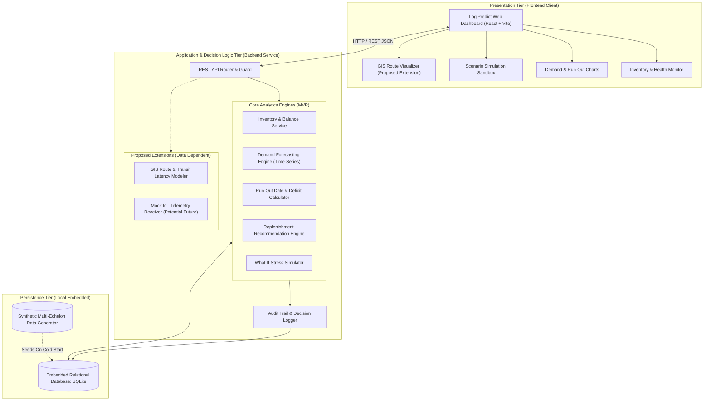
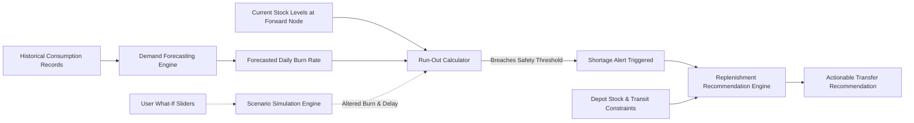

# System Architecture Documentation — LogiPredict AI

> **Product Name:** LogiPredict AI  
> **Official Problem Statement:** SIH PS 26251 — *Indian Army - Predictive Logistics & Forward Supply Chain*  
> **Status:** Proposed Modular Architecture  
> **Target:** Self-Contained, Explainable Student Hackathon Prototype  

---

## 1. Architectural Philosophy & Context

LogiPredict AI is designed as a modular, decision-support platform that transforms fragmented logistics data streams into predictive, actionable supply intelligence.

In accordance with SIH prototype constraints and engineering realism:
1. **Explainable Analytics over Opaque Black Boxes:** The forecasting and replenishment engines prioritize transparent, rule-grounded, and statistical calculations so military logistics evaluators can inspect every underlying variable.
2. **Deterministic Offline Operation:** The entire stack operates locally with zero reliance on cloud APIs, avoiding failure during erratic hackathon connectivity.
3. **Decoupled Extensions:** The core MVP (Inventory, Forecasting, Run-out, Replenishment, Simulation) is decoupled from optional extensions (GIS visualization, IoT telemetry ingestion).

---

## 2. High-Level System Architecture Diagram

---

## 3. Data Relationships & Analytical Pipeline

The predictive logistics workflow links data streams into a continuous decision-support pipeline:

1. **Consumption to Forecast:** Past daily consumption records are processed by the forecasting service to derive predicted burn rates over 7, 14, and 30-day forward windows.
2. **Current Stock + Forecast = Projected Run-Out:** The run-out engine computes remaining days of supply:
   $$\text{Days of Supply} = \frac{\text{Current Usable Stock}}{\text{Forecasted Daily Burn Rate}}$$
3. **Run-Out to Shortage Alert:** When projected run-out falls below the designated safety buffer threshold (e.g. < 5 days), an automated stockout alert is flagged.
4. **Shortage to Replenishment:** The recommendation engine scans upstream base depots for available surplus and computes transfer quantities factoring in transit lead times.
5. **Scenario Simulation (What-If):** Users can introduce stress parameters (e.g. +30% consumption surge, +3 days weather transit delay) to observe how supply lines hold up under operational disruptions.

---

## 4. Module Breakdown & Responsibilities

### 4.1 Core MVP Modules (Confirmed Scope)

| Module | Location | Primary Responsibility |
| :--- | :--- | :--- |
| **Inventory Ledger** | `server/services/inventoryService.js` | Maintains synthetic stock counts, reorder thresholds, and unit categories |
| **Forecast Engine** | `server/services/forecastEngine.js` | Computes statistical moving averages, trend projections, and seasonality adjustments |
| **Replenishment Engine** | `server/services/replenishmentEngine.js` | Identifies deficits and generates suggested depot-to-forward transfers |
| **Scenario Simulator** | `server/services/simulationService.js` | Runs comparative what-if scenarios without mutating baseline ledger state |
| **Audit Logger** | `server/services/auditService.js` | Writes immutable records of approved replenishment orders and parameter modifications |

### 4.2 Proposed Extensions & Future Integrations

| Feature | Scope Status | Rationale & Prerequisite |
| :--- | :--- | :--- |
| **GIS Route Planner** | **Proposed Extension** | Renders spatial topology of synthetic supply lines. Dependent on team selection of a lightweight mapping library (Leaflet/GeoJSON) without requiring live Google Maps API keys. |
| **Weather / Terrain Delay** | **Proposed MVP Model** | Parametric modifier adjusting transit lead-time days. Does not require external live weather APIs; operates via predefined synthetic terrain/weather scenario toggles (e.g. "Monsoon Pass Closure", "Clear Corridor"). |
| **IoT Telemetry Ingestion** | **Potential Future Integration** | The official PS highlights IoT tracking as a technology opportunity. The prototype will document an API contract for sensor telemetry but will NOT claim physical IoT hardware is connected. |

---

## 5. Technology Stack (Proposed Baseline)

> [!NOTE]
> All stack selections below remain **PROPOSED** until the student development team explicitly validates and signs off on the implementation kickoff.

- **Frontend Application:** React (v18+) with Vite build tool. Fast, component-driven, zero unnecessary framework overhead.
- **Styling Architecture:** Vanilla CSS with scoped design tokens (`tokens.css`). Provides complete visual freedom and clean command-dashboard aesthetics without CSS framework lock-in.
- **Backend Service:** Node.js with Express. Asynchronous, event-driven, native JSON handling, standard REST routing.
- **Database Engine:** Embedded SQLite (`better-sqlite3` or `sqlite3`). Completely file-based, zero configuration, zero cloud dependency, 100% reliable for offline hackathon evaluations.
- **Visualization:** Lightweight HTML5 Canvas / SVG charts for forecast curves and run-out projections.

---

## 6. Deployment Architecture

- **Single-Machine Demonstration:** Both client and server run on the local development workstation:
  - Frontend: `http://localhost:5173`
  - Backend API: `http://localhost:5000/api`
- **Unified Static Mode (Fallback):** The frontend can be built (`npm run build`) and served directly by the Express server from a static `/public` directory on port `5000`, guaranteeing single-command portability.
