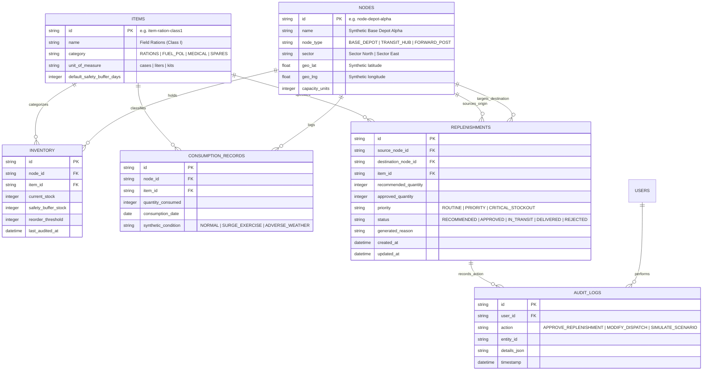

# Database Design & Schema Specifications — LogiPredict AI

> **Product Name:** LogiPredict AI  
> **Official Problem Statement:** SIH PS 26251 — *Indian Army - Predictive Logistics & Forward Supply Chain*  
> **Database Engine:** SQLite (Embedded Local File Storage)  
> **Schema Type:** Normalized Relational with Synthetic Entity Models  

---

## 1. Entity-Relationship Model

---

## 2. Table Specifications & Constraints

### 2.1 Table: `nodes` (Synthetic Logistics Formations)
Represents synthetic holding locations across echelons.

| Column | Type | Constraints | Description |
| :--- | :--- | :--- | :--- |
| `id` | `TEXT` | PRIMARY KEY | Unique synthetic slug (e.g. `node-fp-foxtrot`) |
| `name` | `TEXT` | NOT NULL | Display name (e.g. `Forward Post Foxtrot`) |
| `node_type` | `TEXT` | NOT NULL, CHECK in (`BASE_DEPOT`, `TRANSIT_HUB`, `FORWARD_POST`) | Echelon classification |
| `sector` | `TEXT` | NOT NULL | Synthetic operational sector |
| `geo_lat` | `REAL` | NULLABLE | Abstract synthetic coordinate for map view |
| `geo_lng` | `REAL` | NULLABLE | Abstract synthetic coordinate for map view |
| `capacity_units` | `INTEGER` | NOT NULL, DEFAULT 1000 | Maximum storage capacity |

### 2.2 Table: `items` (Critical Supply Categories)
Logistics commodities tracked within the predictive framework.

| Column | Type | Constraints | Description |
| :--- | :--- | :--- | :--- |
| `id` | `TEXT` | PRIMARY KEY | Unique item slug (e.g. `item-fuel-pol-3`) |
| `name` | `TEXT` | NOT NULL | Item name |
| `category` | `TEXT` | NOT NULL, CHECK in (`RATIONS`, `FUEL_POL`, `MEDICAL`, `SPARES`) | Official logistics class |
| `unit_of_measure` | `TEXT` | NOT NULL | Unit (e.g. `Liters`, `Boxes`, `Kits`) |
| `default_safety_buffer_days` | `INTEGER` | NOT NULL, DEFAULT 7 | Target days of reserve stock |

### 2.3 Table: `inventory` (Live Node Stock Balances)
Current state of supplies held at each node.

| Column | Type | Constraints | Description |
| :--- | :--- | :--- | :--- |
| `id` | `TEXT` | PRIMARY KEY | UUID |
| `node_id` | `TEXT` | FOREIGN KEY REFERENCES `nodes(id)` | Holding location |
| `item_id` | `TEXT` | FOREIGN KEY REFERENCES `items(id)` | Commodity type |
| `current_stock` | `INTEGER` | NOT NULL, CHECK(`current_stock` >= 0) | Available usable inventory |
| `safety_buffer_stock` | `INTEGER` | NOT NULL | Minimum safe quantity buffer |
| `reorder_threshold` | `INTEGER` | NOT NULL | Triggers automated reorder calculation |
| `last_audited_at` | `DATETIME` | DEFAULT CURRENT_TIMESTAMP | Last ledger update |

### 2.4 Table: `consumption_records` (Historical Consumption Ledger)
Daily consumption logs used as input to predictive demand forecasting models.

| Column | Type | Constraints | Description |
| :--- | :--- | :--- | :--- |
| `id` | `TEXT` | PRIMARY KEY | UUID |
| `node_id` | `TEXT` | FOREIGN KEY REFERENCES `nodes(id)` | Consuming formation |
| `item_id` | `TEXT` | FOREIGN KEY REFERENCES `items(id)` | Consumed commodity |
| `quantity_consumed` | `INTEGER` | NOT NULL, CHECK(`quantity_consumed` >= 0) | Units burned in 24 hours |
| `consumption_date` | `DATE` | NOT NULL | Date of consumption |
| `synthetic_condition`| `TEXT` | DEFAULT 'NORMAL' | Synthetic modifier label |

### 2.5 Table: `replenishments` (Dispatch Recommendations & Orders)
Recommendations generated by the system and actioned by the logistics planner.

| Column | Type | Constraints | Description |
| :--- | :--- | :--- | :--- |
| `id` | `TEXT` | PRIMARY KEY | UUID (e.g. `rep-2026-001`) |
| `source_node_id` | `TEXT` | FOREIGN KEY REFERENCES `nodes(id)` | Supplying depot |
| `destination_node_id`| `TEXT` | FOREIGN KEY REFERENCES `nodes(id)` | Receiving forward post |
| `item_id` | `TEXT` | FOREIGN KEY REFERENCES `items(id)` | Commodity to transfer |
| `recommended_quantity`| `INTEGER`| NOT NULL | Algorithmic quantity to avert deficit |
| `approved_quantity` | `INTEGER` | NULLABLE | Planner-adjusted quantity |
| `priority` | `TEXT` | NOT NULL, CHECK in (`ROUTINE`, `PRIORITY`, `CRITICAL_STOCKOUT`) | Urgency tier |
| `status` | `TEXT` | NOT NULL, DEFAULT 'RECOMMENDED' | Order state |
| `generated_reason` | `TEXT` | NOT NULL | Human-readable explainability narrative |
| `created_at` | `DATETIME` | DEFAULT CURRENT_TIMESTAMP | Generation time |

---

## 3. Proposed Extension Schemas (Optional / Phase 2)

### Table: `corridors` *(Proposed GIS Extension)*
Stores synthetic route segments between nodes with estimated transit lead times and terrain delay multipliers.

| Column | Type | Description |
| :--- | :--- | :--- |
| `id` | `TEXT PK` | Route segment identifier |
| `source_node_id` | `TEXT FK` | Upstream dispatch point |
| `target_node_id` | `TEXT FK` | Downstream delivery point |
| `base_transit_days` | `REAL` | Nominal travel duration in days |
| `terrain_difficulty` | `TEXT` | Synthetic terrain tag (`PLAINS`, `HILL_PASS`, `HIGH_ALTITUDE`) |
| `active_delay_days` | `REAL` | Additional weather/delay factor |

---

## 4. Synthetic Seed Data Specification (for Demo)

For the SIH live evaluation, the prototype will be pre-seeded with a complete, coherent synthetic operational scenario:
- **5 Synthetic Logistics Nodes:**
  - `node-depot-alpha` (Base Supply Depot - High inventory surplus)
  - `node-transit-bravo` (Staging & Transit Hub - Moderate stock)
  - `node-fp-charlie` (Forward Post Charlie - Stable stock)
  - `node-fp-delta` (Forward Post Delta - Impending stockout in 4 days)
  - `node-fp-echo` (Forward Post Echo - Critical stockout in 36 hours)
- **4 Standard Supply Items:**
  - Class I: Combat Rations (Packs)
  - Class III: Diesel / High Altitude Fuel (Liters)
  - Class VIII: Critical Medical Trauma Packs (Kits)
  - Class IX: Common Vehicle Replacement Spares (Units)
- **60 Days of Synthetic Historical Consumption Data:**
  - Seeded with realistic seasonal fluctuations to demonstrate the time-series forecasting engine.
- **3 System-Generated Replenishment Recommendations:**
  - Pre-computed dispatches ready for the planner to review and approve during the live pitch.
