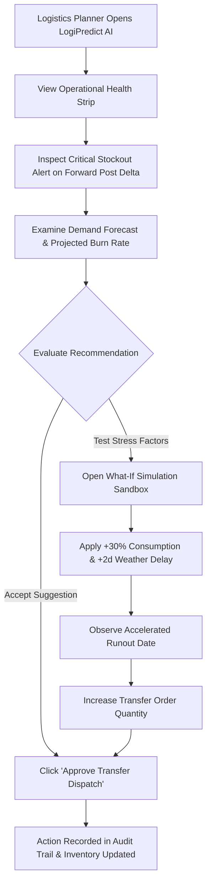

# System Design & UI/UX Specifications — LogiPredict AI

> **Product Name:** LogiPredict AI  
> **Official Problem Statement:** SIH PS 26251 — *Indian Army - Predictive Logistics & Forward Supply Chain*  
> **Status:** Refined Specification / Active Design Baseline  
> **Visual Theme:** Command-Grade Logistics Operations Interface  

---

## 1. UI/UX Principles & Design Objectives

1. **Mission-Critical Clarity:** Military logistics planners make rapid decisions under stress. High-contrast surfaces, explicit status badges, and uncluttered data density must prevent cognitive fatigue.
2. **Explicit Data Provenance:** Every displayed number must be clearly identified with a visual tag:
   - `[ACTUAL]` — Observed historical consumption or real-time ledger count.
   - `[PREDICTED]` — Algorithmic projection of future demand.
   - `[SIMULATED]` — Value adjusted by user what-if parameters.
   - `[SYNTHETIC]` — Baseline badge reminding evaluators all operational data is mock/anonymized.
3. **Action-Oriented Workflows:** Do not stop at showing shortage alerts; directly present a recommended replenishment action with an approval button.
4. **Resilient Local Aesthetics:** Dark charcoal/slate backdrop with high-contrast indicator accents (Emerald for Safe, Amber for Warning, Rose for Critical Stockout Risk, Indigo/Cyan for System Insights).

---

## 2. Design System Tokens

### 2.1 Color Palette

| Token Name | Value | Purpose |
| :--- | :--- | :--- |
| `--color-bg-base` | `#0B111E` (Command Deep Navy) | Primary screen canvas background |
| `--color-bg-surface` | `#131D31` (Slate Armor) | Component cards, modal panels, table containers |
| `--color-bg-elevated` | `#1E2B45` (Tactical Muted) | Dropdowns, table headers, hover highlights |
| `--color-border` | `rgba(255, 255, 255, 0.08)` | Structure dividing borders |
| `--color-primary` | `#3B82F6` (Operational Blue) | Main action buttons, active navigation indicator |
| `--color-accent` | `#06B6D4` (Telemetry Cyan) | Forecast curve highlights, key telemetry readouts |
| `--color-text-main` | `#F8FAFC` (Pure High-Contrast) | Primary labels, metric values, table text |
| `--color-text-muted` | `#94A3B8` (Tactical Slate) | Subtitles, field hints, column descriptions |
| `--color-safe` | `#10B981` (Sufficient Stock) | Stock levels >= 100% of buffer threshold |
| `--color-warning` | `#F59E0B` (Approaching Buffer)| Stock levels between 50% and 99% of buffer |
| `--color-critical` | `#EF4444` (Imminent Stockout)| Stock levels < 50% or run-out projected within 5 days |
| `--color-simulated` | `#8B5CF6` (Simulation Violet) | Indicates what-if simulated curve and altered numbers |

### 2.2 Typography
- **Primary Typography:** System Sans-serif fallback (`Inter`, `system-ui, -apple-system, sans-serif`) with tabular figures enabled (`font-variant-numeric: tabular-nums`) so numbers in tables do not jump during real-time updates.
- **Monospace Telemetry Font:** `ui-monospace, SFMono-Regular, Menlo, Monaco, Consolas, monospace` for Supply Codes, Node IDs, and UUIDs.

---

## 3. Main Screen Layouts

```
+----------------------------------------------------------------------------------------------------+
| [LogiPredict AI]  | SIH PS 26251: Indian Army - Predictive Logistics | [SYNTHETIC DEMO MODE] [Role: Planner v] |
+----------------------------------------------------------------------------------------------------+
| NAV SIDEBAR       | MAIN OPERATIONAL WORKSPACE                                                     |
|                   |                                                                                |
| [1] Overview      | [ Critical Stockouts: 2 ] [ Safe Posts: 14 ] [ Avg Runout: 12d ] [ Transit: 4 ] |
| [2] Inventory     |                                                                                |
| [3] Forecasts     | +----------------------------------------------------------------------------+ |
| [4] Replenishment | | MULTI-ECHELON FORWARD INVENTORY MONITOR                                      | |
| [5] Simulation    | | Filter: [All Nodes v] [Category: All v] [Search: _________]                 | |
| [6] GIS Map*      | | Node ID      | Category    | Current | Daily Burn | Run-Out | Status        | |
| [7] Audit Log     | | Sector-A-FP1 | Rations-I   | 240 pcs | 30 pcs/day | 8 Days  | [WARNING]     | |
|                   | | Sector-B-FP4 | Fuel-POL    | 120 L   | 40 L/day   | 3 Days  | [CRITICAL]    | |
|                   | +----------------------------------------------------------------------------+ |
|                   |                                                                                |
|                   | +------------------------------------+ +-------------------------------------+ |
|                   | | DEMAND FORECAST & RUNOUT TRAJECTORY| | RECOMMENDED DISPATCH TRANSFERS      | |
|                   | | [ACTUAL vs PREDICTED curve]        | | - Send 400L Fuel: Depot-1 -> FP4   | |
|                   | |                                    | |   Reason: Stockout in 72h           | |
|                   | |                                    | |   [ Approve Transfer ] [ Modify ]   | |
|                   | +------------------------------------+ +-------------------------------------+ |
+-------------------+--------------------------------------------------------------------------------+
| * GIS Map is a Proposed Extension for Phase 2 Evaluation. All nodes and routes use synthetic abstract names. |
+----------------------------------------------------------------------------------------------------+
```

### 3.1 Screen Inventory

1. **Executive Operational Dashboard (Overview):**
   - High-level health strip: Total Synthetic Forward Nodes, Imminent Stockout Warnings, Active Replenishment Dispatches, Average Formation Days-of-Supply.
   - Critical Alert Queue: Highest priority supply deficits requiring planner intervention.
2. **Forward Inventory Ledger:**
   - Detailed tabular view of synthetic inventory across forward posts, transit dumps, and base depots.
   - Filterable by Node, Supply Category (`Class I Rations`, `Class III Fuel/POL`, `Medical`, `General Engineering`), and Health Status.
3. **Predictive Demand & Forecast Explorer:**
   - Dual-line visualization comparing observed historical daily burn `[ACTUAL]` against algorithmically projected demand `[PREDICTED]`.
   - Projected run-out date timeline displaying when stock breaches safety thresholds.
4. **Replenishment Recommendation & Action Suite:**
   - Card deck of system-generated transfer suggestions (Source Depot, Target Post, Suggested Quantity, Transport Feasibility, Urgency Tier).
   - "One-Click Approve" action that transfers the recommendation into the dispatched queue and writes an immutable audit record.
5. **What-If Scenario Simulation Sandbox:**
   - Parameter sliders:
     - *Consumption Stress Multiplier:* (e.g. 1.0x to 2.5x surge).
     - *Transit Lead Time Delay:* (e.g. +0 to +7 days weather/pass delay).
   - Comparative chart: Baseline Projected Stock vs. Simulated Stress Trajectory `[SIMULATED]`.
6. **Geospatial (GIS) Map View *(Proposed Extension)*:**
   - Abstract topological or geospatial map plotting synthetic nodes (Depot Alpha, Transit Beta, Forward Post Gamma) with supply corridor connections and delay indicators.

---

## 4. User Journeys & Workflow Navigation



---

## 5. Demonstration Data Labelling Rules

To maintain strict academic integrity during SIH jury evaluations:
1. Every mock node must carry the synthetic badge (e.g. `Synthetic Node: Sector Alpha Depot`).
2. Real-world geographical coordinates, military unit numbers, and tactical locations are strictly prohibited.
3. If an evaluator asks about data origins, the UI includes a permanent top-bar indicator: *"Demo Mode: 100% Synthetic Formations & Commodities for SIH PS 26251 Demonstration."*
