# Implementation Plan & Task Breakdown — LogiPredict AI

> **Product Name:** LogiPredict AI  
> **Official Problem Statement:** SIH PS 26251 — *Indian Army - Predictive Logistics & Forward Supply Chain*  
> **Approach:** Phased, MVP-First Demonstrable Student Roadmap  

---

## 1. Roadmap Phasing Strategy

```mermaid
gantt
    title LogiPredict AI Prototype Phasing
    dateFormat  X
    axisFormat %s

    section Phase 1: Planning
    Documentation Refinement (Official PS 26251) :done, 0, 10
    
    section Phase 2: MVP Scaffolding
    Synthetic Data Seeder & Project Setup : 10, 25
    Inventory & Multi-Echelon Ledger      : 25, 40
    
    section Phase 3: Predictive Core
    Demand Forecasting & Run-Out Engine   : 40, 55
    Replenishment Recommendation Engine   : 55, 70
    
    section Phase 4: What-If Simulation
    Scenario Simulation & Explainability  : 70, 85
    
    section Phase 5: Demo Polish
    Testing, Rehearsal & SIH Pitch Prep   : 85, 100

    section Phase 6: Optional Extensions
    GIS Route View (Feasibility Dependent): 100, 115
    Mock IoT Telemetry Contract (Optional): 115, 125
```

---

## 2. Phase-by-Phase Task Matrix

### Phase 1: Planning & Specification Foundation *(CURRENT PHASE)*
- **Task 1.1:** Incorporate official SIH PS 26251 details (MoD, DSSC, PS Title, Theme). `[COMPLETED]`
- **Task 1.2:** Establish synthetic data boundaries and operational sensitivity safeguards. `[COMPLETED]`
- **Task 1.3:** Align PRD, Design, Architecture, Database, and API specs around core MVP. `[COMPLETED]`
- **Task 1.4:** User review, evaluation of tech stack, and explicit approval before any code creation. `[GATE]`

---

### Phase 2: Project Scaffolding & Synthetic Multi-Echelon Data
*Prerequisite: Phase 1 sign-off.*
- **Task 2.1:** Initialize frontend workspace (`client/`) with Vite + React.
- **Task 2.2:** Configure command-grade design system tokens in `client/src/styles/tokens.css`.
- **Task 2.3:** Initialize backend service (`server/`) with Express and local SQLite driver.
- **Task 2.4:** Build reproducible synthetic seed generator (`npm run seed`) creating the 5-node, 4-commodity forward logistics scenario.
- **Completion Criteria:** Single terminal command boots frontend and backend with fully populated synthetic inventory.

---

### Phase 3: Demand Forecasting & Replenishment Engines
*Prerequisite: Phase 2 completion.*
- **Task 3.1:** Implement time-series demand forecasting service calculating 7/14/30-day predicted consumption from historical burn.
- **Task 3.2:** Implement run-out date engine computing days-of-supply remaining and flagging buffer breaches.
- **Task 3.3:** Build replenishment recommendation algorithm identifying surplus at base depots and generating prioritized dispatch transfers.
- **Task 3.4:** Build Interactive Forecast Chart component displaying `[ACTUAL]` vs. `[PREDICTED]` demand and projected inventory curves.
- **Completion Criteria:** Forward post with impending deficit triggers automated transfer suggestion with complete calculation narrative.

---

### Phase 4: What-If Scenario Simulation & Decision Actioning
*Prerequisite: Phase 3 completion.*
- **Task 4.1:** Build What-If simulation service taking consumption surge multipliers and transit delay inputs.
- **Task 4.2:** Build Simulation Sandbox UI with interactive sliders and comparative trajectory chart (`[BASELINE]` vs. `[SIMULATED]`).
- **Task 4.3:** Implement one-click replenishment approval workflow writing immutable audit trail entries.
- **Task 4.4:** Build Executive Overview Health Strip showing critical stockout alerts and average forward days-of-supply.
- **Completion Criteria:** Logistics planner can simulate a +30% consumption surge, observe accelerated stockout, adjust transfer quantity, and approve the dispatch.

---

### Phase 5: Testing, Hardening & SIH Jury Demonstration Rehearsal
*Prerequisite: Phase 4 completion.*
- **Task 5.1:** Execute full test suite per `Testing.md` (functional, boundary, and offline resilience).
- **Task 5.2:** Test cold reset command (`npm run db:reset-seed`) ensuring instant recovery during live demos.
- **Task 5.3:** Run offline audit: disconnect internet and verify 100% operational integrity.
- **Task 5.4:** Conduct timed 4-minute demonstration rehearsal covering the complete end-to-end user journey.
- **Completion Criteria:** Zero console errors, sub-second response times, 100% offline reliability.

---

### Phase 6: Optional Extensions (Subsequent Evaluation)
*Deferred until MVP completion and explicit data feasibility verification:*
- **Task 6.1 (GIS Extension):** Evaluate lightweight Leaflet / GeoJSON integration for abstract node rendering without external Google Maps API key requirements.
- **Task 6.2 (Terrain/Weather Parametric Modifier):** Integrate selectable route constraint toggles ("Winter Pass Closure", "Monsoon Delay") modifying base transit lead times.
- **Task 6.3 (IoT Telemetry Contract):** Document mock webhook payload receiver for cargo temperature and pallet scans.
